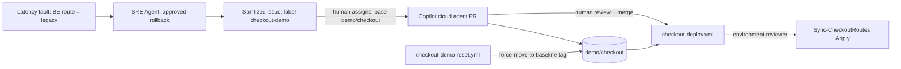

# Checkout code loop: SRE incident to reviewed config change

Implements [#44](https://github.com/rutgerpels/retailtx-agentic-ops-demo/issues/44)
on top of the [checkout continuity scenario](checkout-latency-scenario.md).
SRE Agent repairs the live incident and files a sanitized drift issue. GitHub
Copilot turns the issue into a pull request. A reviewer-gated workflow applies
the declared routes. A reset workflow restores the demo branch for the next run.

**Status:** implemented and covered by mocked tests. Not yet rehearsed live.

## Flow



| Step | Actor | Gate |
|---|---|---|
| Roll back the live route | SRE Agent | Review-mode approval card (unchanged) |
| Create or comment on one issue | SRE Agent GitHub connector | Issue tools are in the approval policy `ask` list |
| Open a pull request into `demo/checkout` | Copilot cloud agent | A human assigns the issue and selects the base branch |
| Merge | Human reviewer | Normal pull request review |
| Apply the declared routes | `checkout-deploy.yml` | `checkout-deploy` environment reviewer; `demo/checkout` only |
| Restore the demo | `checkout-demo-reset.yml` | `checkout-demo-reset` environment reviewer; runs from `main` only |

`main` is never a target. Copilot's change lands on `demo/checkout`, and reset
moves that branch back to an immutable tag on `main`'s history.

## Declared routes

[`infra/checkout/price-routes.json`](../infra/checkout/price-routes.json) is the
single source of truth for `PRICE_ROUTE_BE`, `PRICE_ROUTE_NL` and
`ROUTE_CHANGE_REF`. Bicep loads it with `loadJsonContent`, and
[`scripts/Sync-CheckoutRoutes.ps1`](../scripts/Sync-CheckoutRoutes.ps1) compares
it with the live web app:

- `Check` fails on drift; `Apply` writes only the drifted keys and reads back.
- The file must contain exactly these three keys. Routes must be `primary` or
  `legacy`, and the change reference must match `^[A-Za-z0-9._-]{1,64}$`.
- The Azure CLI query returns only the three route keys. Other app settings,
  including the Application Insights connection string, never reach the log.

The committed baseline is `primary`/`primary`/`baseline`, which matches the fault
lifecycle's baseline. Run `Ready` after the SRE rollback and **before** merging
or resetting, so the lifecycle retires the fault with evidence bound to it.
A deploy during an active fault restores the baseline routes, but `Ready` then
refuses to retire the fault because the change reference no longer belongs to
it. Recover with `Undo -Scenario latency` (idempotent) and then `Ready`.

## One-time setup

Run after merging this change. Order matters.

```powershell
$sub = '<subscription-id>'
# 1. Label and reset environment (reviewer = you, main only)
.\scripts\Invoke-CheckoutDemoRepo.ps1 Configure
# 2. Manual: create the fine-grained token and store it as the DEMO_RESET_TOKEN
#    environment secret on checkout-demo-reset (see below)
# 3. Tag main as demo-baseline/checkout-v1 and create demo/checkout
.\scripts\Invoke-CheckoutDemoRepo.ps1 Baseline
# 4. Deploy identity and checkout-deploy environment (reviewer = you)
.\scripts\Invoke-CheckoutDeployIdentity.ps1 Configure -SubscriptionId $sub
# 5. After checkout Up: scope the route writer role to the web app
.\scripts\Invoke-CheckoutDeployIdentity.ps1 Grant -SubscriptionId $sub -CheckoutEnvironmentName checkout01
.\scripts\Invoke-CopilotCloudAgent.ps1 Grant -SubscriptionId $sub -CheckoutEnvironmentName checkout01
# 6. After adding the SRE GitHub connector in the portal and listing its tools
.\scripts\Invoke-CheckoutDemo.ps1 ConfigureFollowUp -SubscriptionId $sub -EnvironmentName checkout01 `
  -IssueRepository rutgerpels/retailtx-agentic-ops-demo -SreIssueTools '<create-issue-tool>', '<search-issues-tool>', '<comment-tool>'
.\scripts\Invoke-CheckoutDemo.ps1 Ready -SubscriptionId $sub -EnvironmentName checkout01
```

### Reset token (manual)

The reset moves `demo/checkout` across commits that may change workflow files.
`GITHUB_TOKEN` cannot push workflow changes, so the reset uses a fine-grained
personal access token:

- Repository access: this repository only.
- Permissions (read and write): Contents, Issues, Pull requests, Workflows,
  Actions.
- Expiry: about 30 days. Rotate before rehearsals.
- Store it only as the **environment** secret `DEMO_RESET_TOKEN` on
  `checkout-demo-reset`, so it is released only after a reviewer approves a run
  from `main`.

### SRE GitHub connector (manual, before rehearsal)

Add the GitHub connector in the SRE Agent portal, then list the investigator's
available tools to get exact names. Pass only issue search, create and comment
tools to `ConfigureFollowUp`. Do not pass pull request, push or assignment tools.
`ConfigureFollowUp` without `-IssueRepository` disables the follow-up.

## Demo run

1. `Ready`, then `Inject -Scenario latency`; approve the SRE rollback as usual.
2. Approve the SRE issue-creation card. The issue references the change
   reference, `price-routes.json` and `checkout.bicep`, and asks for a drift
   check and regression test on `demo/checkout`.
3. Wait for fresh healthy evidence and run `Ready` to retire the fault.
4. Assign the issue to Copilot and choose base branch **`demo/checkout`**.
5. Review and merge Copilot's pull request into `demo/checkout`.
6. Approve the `checkout-deploy` environment run. The step summary shows
   declared versus live routes; it resets the leftover fault change reference
   to `baseline`.

## Reset

Actions → **Checkout Demo Reset** → Run workflow on `main` (baseline tag
`demo-baseline/checkout-v1`), then approve the environment. The reset:

1. Comments on and closes open pull requests into `demo/checkout`.
2. Deletes same-repository `copilot/*` head branches of open, merged or closed
   pull requests into `demo/checkout`, except branches an open pull request into
   another base still uses.
3. Closes open `checkout-demo` issues as not planned.
4. Force-moves `demo/checkout` to the tag commit and verifies it.

Moving the branch triggers the gated deploy, which restores the baseline routes.
Set `redeploy` only if the branch was already at the baseline.
`Invoke-CheckoutDemoRepo.ps1 Check` reports whether the branch is at baseline
and lists open demo items. The same `Reset` action can run locally with `gh`.

To adopt newer `main` content, run `Baseline` to create the next
`demo-baseline/checkout-vN` tag, then reset to it. Baseline tags must be
lightweight tags on `main`'s history.

## Teardown

```powershell
.\scripts\Invoke-CheckoutDeployIdentity.ps1 Remove -SubscriptionId $sub
.\scripts\Invoke-CheckoutDemo.ps1 ConfigureFollowUp -SubscriptionId $sub -EnvironmentName checkout01  # disable
```

Remove deletes the environment, role assignments, custom role, owned resource
group and local state. Checkout `Down` deletes the web app and any assignment on
it. Delete the reset token, `demo/checkout` and baseline tags manually when the
demo is retired.

## Limits

- The route writer role includes `Microsoft.Web/sites/config/write` and
  `config/list/action` on one web app. It can change any app setting on that
  app, not only routes; the workflow and reviewer gate keep it to the declared
  keys.
- A pull request into `demo/checkout` may change `checkout-deploy.yml` itself.
  It is still bounded by human merge review, the environment reviewer and the
  single-app role.
- The reset token has write access to this repository. Keep it short-lived and
  environment-scoped.
- SRE connector tool names and whether the approval policy covers connector
  tools are not yet verified.

## Verification status

| Item | Status |
|---|---|
| Route validation, drift detection, key-only query | `tests\Test-CheckoutCodeLoop.ps1` (mocked) |
| Reset touches only demo pull requests, issues and branch | `tests\Test-CheckoutCodeLoop.ps1` (mocked) |
| Workflow guards and pinned actions | `tests\Test-CheckoutCodeLoop.ps1` (static) |
| Follow-up instruction, tools and approval drift | `tests\Test-CheckoutDemo.ps1` (mocked) |
| Bicep build with loaded routes | `az bicep build` |
| Deploy role sufficiency, OIDC deploy, reset token, SRE issue creation, Copilot PR | Not yet verified live |
