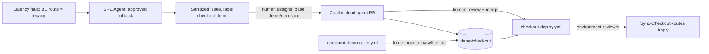

# Checkout code loop: SRE incident to reviewed config change

Implements [#44](https://github.com/rutgerpels/retailtx-agentic-ops-demo/issues/44)
on top of the [checkout continuity scenario](checkout-latency-scenario.md).
SRE Agent repairs the live incident and files a sanitized drift issue. GitHub
Copilot turns the issue into a pull request. A reviewer-gated workflow applies
the declared routes. A reset workflow restores the demo branch for the next run.

**Status:** technical paths verified live (2026-10-18): scoped identity grants,
latency alert and human-approved SRE repair, GitHub OIDC route write, and
PAT-backed demo-branch reset. The full SRE issue-to-Copilot pull request loop
is not yet verified: the SRE GitHub connector is still unconfigured. The
temporary checkout fixture was torn down; one-time identity setup is retained.

## Flow



| Step | Actor | Gate |
|---|---|---|
| Roll back the live route | SRE Agent | Review-mode approval card (unchanged) |
| Create or comment on one issue | SRE Agent GitHub connector | Issue tools are in the approval policy `ask` list |
| Open a pull request into `demo/checkout` | Copilot cloud agent | A human assigns the issue and selects the base branch |
| Merge | Human reviewer | Normal pull request review |
| Apply or check declared routes | `checkout-deploy.yml` | `checkout-deploy` environment reviewer; `demo/checkout` only |
| Restore the demo | `checkout-demo-reset.yml` | `checkout-demo-reset` environment reviewer; runs from `main` only |

`main` is never a target. Copilot's change lands on `demo/checkout`, and reset
moves that branch back to an immutable tag on `main`'s history.

## Declared routes

[`infra/checkout/price-routes.json`](../infra/checkout/price-routes.json) is the
single source of truth for `PRICE_ROUTE_BE`, `PRICE_ROUTE_NL` and
`ROUTE_CHANGE_REF`. Bicep loads it with `loadJsonContent`, and
[`scripts/Sync-CheckoutRoutes.ps1`](../scripts/Sync-CheckoutRoutes.ps1) compares
it with the live web app:

- `Check` fails on drift; `Apply` writes only the drifted keys and reads back.
- The file must contain exactly these three keys. Routes must be `primary` or
  `legacy`, and the change reference must match `^[A-Za-z0-9._-]{1,64}$`.
- The Azure CLI query returns only the three route keys. Other app settings,
  including the Application Insights connection string, never reach the log.

### Read-only drift check

The existing **Checkout Routes Deploy** workflow supports a manual `mode`
choice. To select the version on `demo/checkout` and request a read-only check,
run:

```sh
gh workflow run checkout-deploy.yml --ref demo/checkout -f mode=check
```

After the updated workflow is on `demo/checkout`, this dispatch selects that
branch's workflow version; the workflow file is already registered on the
default branch. Approve the `checkout-deploy` environment when prompted. The
check succeeds when all three declared settings match, and fails with the
differing setting names when drift is detected. It does not repair drift.
Without `mode=check`, manual dispatch defaults to `Apply`; pushes to
`demo/checkout` continue to apply as before.

This documents how to dispatch the check; it does not claim that this PR has
run it against live routes. Run it only after the change is reviewed and merged
to `demo/checkout`, then approve the environment.

The check uses the existing checkout-deploy OIDC identity and scoped app
configuration role, which retains write permission for the deploy workflow.
In Check mode, the job performs no Azure write and invokes only the existing
`Sync-CheckoutRoutes.ps1 Check` action; other modes retain the existing apply
behavior.

The committed baseline is `primary`/`primary`/`baseline`, which matches the fault
lifecycle's baseline. Run `Ready` after the SRE rollback and **before** merging
or resetting, so the lifecycle retires the fault with evidence bound to it.
A deploy during an active fault restores the baseline routes, but `Ready` then
refuses to retire the fault because the change reference no longer belongs to
it. Recover with `Undo -Scenario latency` (idempotent) and then `Ready`.

## One-time setup

Run after merging this change. Order matters.

```powershell
$sub = '<subscription-id>'
# 1. Label and reset environment (reviewer = you, main only)
.\scripts\Invoke-CheckoutDemoRepo.ps1 Configure
# 2. Manual: create the fine-grained token and store it as the DEMO_RESET_TOKEN
#    environment secret on checkout-demo-reset (see below)
# 3. Create the next immutable baseline tag on main and create demo/checkout if absent.
#    Keep the returned tag name; v1 is only the first baseline.
.\scripts\Invoke-CheckoutDemoRepo.ps1 Baseline
# 4. Deploy identity and checkout-deploy environment (reviewer = you)
.\scripts\Invoke-CheckoutDeployIdentity.ps1 Configure -SubscriptionId $sub
# 5. After checkout Up: scope the route writer role to the web app
.\scripts\Invoke-CheckoutDeployIdentity.ps1 Grant -SubscriptionId $sub -CheckoutEnvironmentName checkout01
.\scripts\Invoke-CopilotCloudAgent.ps1 Grant -SubscriptionId $sub -CheckoutEnvironmentName checkout01
# 6. After adding the SRE GitHub connector in the portal and listing its tools
.\scripts\Invoke-CheckoutDemo.ps1 ConfigureFollowUp -SubscriptionId $sub -EnvironmentName checkout01 `
  -IssueRepository rutgerpels/retailtx-agentic-ops-demo -SreIssueTools '<create-issue-tool>', '<search-issues-tool>', '<comment-tool>'
.\scripts\Invoke-CheckoutDemo.ps1 Ready -SubscriptionId $sub -EnvironmentName checkout01
```

### Reset token (manual)

The reset moves `demo/checkout` across commits that may change workflow files.
`GITHUB_TOKEN` cannot push workflow changes, so the reset uses a fine-grained
personal access token:

- Repository access: this repository only.
- Permissions (read and write): Contents, Issues, Pull requests, Workflows,
  Actions.
- Expiry: about 30 days. Rotate before rehearsals.
- Store it only as the **environment** secret `DEMO_RESET_TOKEN` on
  `checkout-demo-reset`, so it is released only after a reviewer approves a run
  from `main`.

### SRE GitHub connector (manual, before rehearsal)

Add the GitHub connector in the SRE Agent portal, then list the investigator's
available tools to get exact names. Pass only issue search, create and comment
tools to `ConfigureFollowUp`. Do not pass pull request, push or assignment tools.
`ConfigureFollowUp` without `-IssueRepository` disables the follow-up.

### Fresh deployment and approval checks

Creating the baseline branch can trigger the deploy workflow before its
environment secrets or checkout target exist. That early failure is not an
OIDC test. Finish `Configure` and `Grant`, then dispatch **Checkout Routes
Deploy** on `demo/checkout` and approve its environment.

During the first fresh dry-run, ARM created the Log Analytics workspace but
the latency alert failed with **The workspace could not be found**. The
deployment was terminal, and the exact workspace's `AppRequests` query later
succeeded. Re-running the same owned `Up` then succeeded. If this occurs,
inspect the failed operation and query availability before retrying; do not
delete the ownership manifest, adopt another group or disable query
validation. A nonterminal deployment or unknown Arc command must be observed,
not replayed. Workspace propagation remains a fresh-deployment reliability
limit, not a verified automatic retry mechanism.

An SRE text proposal is not a native approval card. The dry-run initially
needed a prompt to request the exact rollback through `RunAzCliWriteCommands`.
Only the resulting native card was approved, without allow-for-thread.
The tool resumed after approval and Azure recorded the expected SRE identity's
configuration write. The resumed result did not contain another pending card;
that is not evidence that execution failed. Read the existing execution,
live routes and fresh telemetry instead of requesting the command again.

The investigator guidance now explicitly requests the native tool gate and
explains approval/resume semantics. After retiring the first fault, the
guidance was refreshed at the healthy baseline. A second independently
injected latency incident produced the exact native rollback card without a
steering message; the human again approved only that action. SRE then verified
recovery and wrote its incident note without another prompt or write replay.
Azure audit showed the bound SRE identity's successful write after approval.

Fresh telemetry established recovery before the stateful alert naturally
resolved. In this run, natural alert clearance took about 17 minutes after the
rollback; `Ready` correctly blocked reuse until then. Include this wait in
rehearsals, and do not equate an acknowledgement or the agent's description of
an alert-history state change with Monitor's `Resolved` condition. Review
incident-note timestamps against the approval and configuration-write audit.
This dry-run does not establish a 12-minute end-to-end presentation.

## Demo run

1. `Ready`, then `Inject -Scenario latency`; approve the SRE rollback as usual.
2. Approve the SRE issue-creation card. The issue references the change
   reference, `price-routes.json` and `checkout.bicep`, and asks for a drift
   check and regression test on `demo/checkout`.
3. Wait for fresh healthy evidence and run `Ready` to retire the fault.
4. Assign the issue to Copilot and choose base branch **`demo/checkout`**.
5. Review and merge Copilot's pull request into `demo/checkout`.
6. Approve the `checkout-deploy` environment run. The step summary shows
   declared versus live routes; it resets the leftover fault change reference
   to `baseline`.

## Reset

Actions → **Checkout Demo Reset** → Run workflow on `main` (baseline tag
`demo-baseline/checkout-v1`), then approve the environment. The reset:

1. Comments on and closes open pull requests into `demo/checkout`.
2. Deletes same-repository `copilot/*` head branches of open, merged or closed
   pull requests into `demo/checkout`, except branches an open pull request into
   another base still uses.
3. Closes open `checkout-demo` issues as not planned.
4. Force-moves `demo/checkout` to the tag commit and verifies it.

Moving the branch triggers the gated deploy, which restores the baseline routes.
Set `redeploy` only if the branch was already at the baseline.
`Invoke-CheckoutDemoRepo.ps1 Check` reports whether the branch is at baseline
and lists open demo items. The same `Reset` action can run locally with `gh`.

To adopt newer `main` content, run `Baseline` to create the next
`demo-baseline/checkout-vN` tag, then reset to it. Baseline tags must be
lightweight tags on `main`'s history.

The technical dry-run moved `demo/checkout` to
`demo-baseline/checkout-v2`. For that baseline, pass
`-BaselineTag demo-baseline/checkout-v2` to `Check` and `Reset`, and select the
same tag in the reset workflow. The default `v1` input does not automatically
follow newer tags.

## Teardown

```powershell
.\scripts\Invoke-CheckoutDeployIdentity.ps1 Remove -SubscriptionId $sub
.\scripts\Invoke-CheckoutDemo.ps1 ConfigureFollowUp -SubscriptionId $sub -EnvironmentName checkout01  # disable
```

Remove deletes the environment, role assignments, custom role, owned resource
group and local state. Checkout `Down` deletes the web app and any assignment on
it. Delete the reset token, `demo/checkout` and baseline tags manually when the
demo is retired.

## Limits

- The route writer role includes `Microsoft.Web/sites/config/write` and
  `config/list/action` on one web app. It can change any app setting on that
  app, not only routes; the workflow and reviewer gate keep it to the declared
  keys.
- A pull request into `demo/checkout` may change `checkout-deploy.yml` itself.
  It is still bounded by human merge review, the environment reviewer and the
  single-app role.
- The reset token has write access to this repository. Keep it short-lived and
  environment-scoped.
- SRE connector tool names and whether the approval policy covers connector
  tools are not yet verified.

## Verification status

| Item | Status |
|---|---|
| Route validation, drift detection, key-only query, and no-write check contract | `tests\Test-CheckoutCodeLoop.ps1` (mocked) |
| Reset touches only demo pull requests, issues and branch | `tests\Test-CheckoutCodeLoop.ps1` (mocked) |
| Repository Check/Reset and deploy-identity Check cardinality | Actual entry functions exercised with empty, singleton and multiple mocked results, plus a missing deploy environment |
| Workflow branch/reviewer guards, Check/Apply selection and pinned actions | `tests\Test-CheckoutCodeLoop.ps1` (static) |
| Follow-up instruction, tools and approval drift | `tests\Test-CheckoutDemo.ps1` (mocked) |
| Bicep build with loaded routes | `az bicep build` |
| Scoped deploy/Copilot identities | Live readback: route writer on one checkout app; Copilot Reader on its resource group only |
| GitHub OIDC and route read | Human-approved [dry-run](https://github.com/rutgerpels/retailtx-agentic-ops-demo/actions/runs/39109848892) passed with routes already matching |
| Live latency fault and approved rollback | First run required steering. Corrected guidance produced the second run's native card, repair and recovery note without steering; one action-only human approval and the bound action identity's successful write were verified |
| Fresh recovery and fault retirement | Second run: SRE reported BE p95 169 ms over 53 successful requests, primary ERP dependency only. After natural alert resolution, `Ready` passed at BE/NL p95 86 ms with at least 95 samples per country and no active fault |
| PAT-backed reset | Human-approved [reset](https://github.com/rutgerpels/retailtx-agentic-ops-demo/actions/runs/39119272717) moved only `demo/checkout` from `v1` to `v2`; independent checks confirmed `main` unchanged. There were no open demo issues/PRs or Copilot branches, so their live cleanup remains unverified |
| Scoped route-write permissions | Human-approved [post-reset deploy](https://github.com/rutgerpels/retailtx-agentic-ops-demo/actions/runs/39119652888) wrote the leftover change reference to `baseline` and read back all three declared keys. `Ready` then passed at BE p95 187 ms (n=96), NL 210 ms (n=99) |
| Fixture teardown | Verified: group absent, zero owner-tagged active resources, no Arc/custom command role or subscription grants, no owned Monitor default setting or deployment records, and no deploy/Copilot role assignments. The route-writer role definition was also absent after deletion. The first Down retained its manifest while an ARM deployment-record deletion propagated; an idempotent retry completed. One-time identities and GitHub environments/secrets are intentionally retained; normal Azure soft-delete/data retention was not purged |
| SRE issue creation and Copilot PR | Not yet verified live; the fresh SRE Agent has no GitHub connector |
