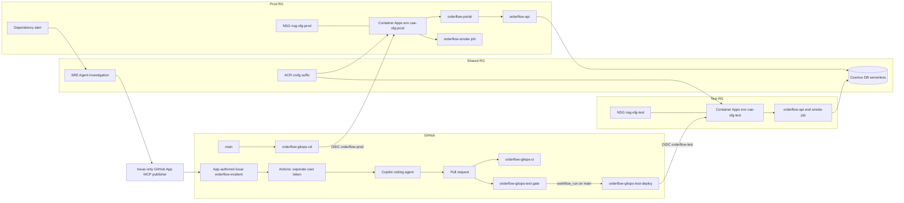

# OrderFlow option 2: GitOps

Option 2 runs the existing OrderFlow app (`scenarios/orderflow/app/`) on Azure
Container Apps and changes production only through pull requests merged to
`main`. A predefined pull request adds an outbound NSG deny that breaks the
Cosmos DB dependency. Azure SRE Agent investigates and files a GitHub issue. The
Copilot coding agent proposes a fix. The fix is proven in a test environment
before a human merges it.

Option 1 (`scenarios/orderflow/`, VM plus App Service, SRE Agent repairs the NSG
after native approval) is unchanged. See [../README.md](../README.md).

**Fresh deployment and full rehearsal:** follow the
[A-Z rehearsal guide](docs/rehearsal.md), including baseline preparation, retained
workflow approvals, new identity trust and the exact-head pre-merge test gate.

## Architecture

Authentication: use the default [GitHub App publisher](docs/github-app-setup.md)
or the supervised [detailed PAT owner setup](docs/github-pat-setup.md). Both keep Copilot
assignment in Actions with a separate user credential. PAT mode skips publisher
infrastructure but lacks the publisher's durable issue reservation. Publication
defaults to a native SRE card; the explicit `-SreIssueWriteApproval Automatic`
option allows only the exact publication tool while retaining read approvals,
denied Azure writes and human production merges. The diagram shows the default App path.

Each stage has its own VNet, subnet and NSG built from
`deploy/network-rules.json`. Both stages share ACR, Cosmos DB (one database per
stage) and identities in the shared resource group. The NSG manages outbound
traffic only: portal inbound traffic reaches the external environment through
its public IP in the managed resource group, not through the subnet NSG, so no
inbound rule is needed (documented:
[firewall integration](https://learn.microsoft.com/azure/container-apps/firewall-integration);
not live-verified).

## Flow

1. **Healthy.** `Up` deploys shared, test and prod; both smoke jobs pass.
2. **Fault.** `Fault` opens the predefined pull request
   "Segment OrderFlow data tier: deny lateral VNet access to the data subnet".
   It adds an NSG deny from the apps subnet to the data subnet that holds the
   private-only Cosmos DB endpoint. It passes CI. The presenter merges it.
3. **Impact.** CD deploys production; the smoke job fails and the run fails
   visibly. The portal shows an order error and the dependency alert fires.
4. **Investigation.** SRE Agent correlates the alert with the merged change and
   publishes one `orderflow-incident` issue through the selected connector.
   Publication requires a native card by default; the explicit Automatic mode
   omits only that write card. The explicitly enabled
   `orderflow-gitops-handoff.yml` workflow assigns Copilot with a separate user
   credential. SRE never receives that credential or an assignment tool.
5. **Fix.** Copilot opens a draft pull request that changes only
   `deploy/network-rules.json`, for example adding `AllowAppsToCosmosPrivateEndpoint`.
6. **Test.** The unprivileged gate (`orderflow-gitops-test.yml`) checks the
   author or label and that only `deploy/network-rules.json` changed. On success,
   `orderflow-gitops-test-deploy.yml` runs from `main` (`workflow_run`),
   re-verifies the pull request, deploys `main` plus only that rules file to the
   test environment, runs the smoke job and marks the pull request ready. No pull
   request code runs with the test identity.
7. **Release.** A human reviews and merges; CD deploys production and the smoke
   job passes.
8. **Reset.** `Reset` opens a pull request that restores the baseline rules.

## How it differs from option 1

| Aspect | Option 1 | Option 2 (GitOps) |
| --- | --- | --- |
| Platform | VM backend and App Service portal | Container Apps (Consumption workload profile) |
| Fault injection | Lifecycle script changes Azure directly | Predefined pull request merged to `main` |
| SRE Agent action | Repairs the NSG after native approval | Azure reads and one incident issue; Actions assigns Copilot separately |
| Fix path | Azure write by the agent | Copilot pull request, test deployment, human merge, CD |
| Environments | One | Always-on test plus production |

The investigator's Azure tools are read-only, but its identity is not strictly
RBAC read-only: Azure SRE Agent preconfigures subscription-level Monitoring
Contributor even at Reader permission level and can restore it during native
approval. The lifecycle accepts only that exact built-in role at the owned
subscription as an exception to reader roles. It never grants the exception
itself or accepts Contributor, Network Contributor or other write roles.
Monitoring changes are possible through that RBAC role; NSG/infrastructure
repairs remain outside this investigator's tools and permissions. See
[Azure SRE Agent permissions](https://sre.azure.com/docs/concepts/permissions).

## Layout

| Path | Purpose |
| --- | --- |
| `deploy/network-rules.json` | The only reviewed runtime surface for fault, fix and reset |
| `deploy/baseline/` | Healthy rules used by `Reset` |
| `deploy/*.bicepparam` | Stage values without identifying data |
| `infra/` | `shared.bicep`, `env.bicep`, `sre.bicep`, `env-data.bicep` (presenter-only Cosmos DB private endpoint per stage) |
| `container/Dockerfile` | One image for portal, API and smoke job |
| `tools/` | `image_tag.py`, `check_rules.py` (offline, stdlib only) |
| `scripts/` | Presenter lifecycle `Invoke-OrderFlowGitOps.ps1` |
| `publisher/` | Authenticated MCP server; issue-only GitHub App installation tokens and durable no-replay receipts |
| `tests/` | Offline contract, rule and workflow tests |

Workflows: `.github/workflows/orderflow-gitops-{ci,test,test-deploy,cd,handoff}.yml`.

## Documentation

- [docs/demo.md](docs/demo.md): presenter run sheet.
- [docs/rehearsal.md](docs/rehearsal.md): A-Z fresh deployment, approvals,
  healthy/fault/test/recovery checkpoints and owned cleanup.
- [docs/operations.md](docs/operations.md): lifecycle commands, costs and
  verification status.
- [docs/github-settings.md](docs/github-settings.md): environments, OIDC, Copilot
  and connector settings.
- [docs/github-app-setup.md](docs/github-app-setup.md): default App authentication,
  publisher deployment, separate user-token handoff and owner actions.
- [docs/github-pat-setup.md](docs/github-pat-setup.md): detailed selected-PAT
  walkthrough, two-token permissions, owner commands, expected results,
  approval boundaries and troubleshooting.
- [docs/runbook.md](docs/runbook.md): SRE Agent investigation instructions.
- [AGENTS.md](AGENTS.md): rules for contributors and the Copilot coding agent.

Production recovery was observed on November 4, 2026, including a new persisted
portal order and resolved dependency alert. The full pre-merge test-deployment
loop remains unverified; do not describe the complete flow as proven. See
[docs/operations.md](docs/operations.md#verification-status).
