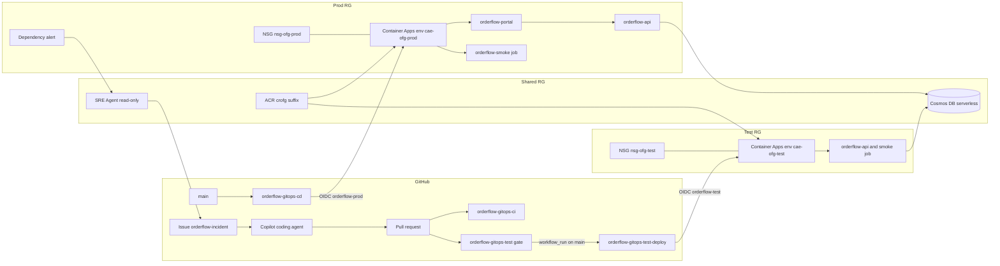

# OrderFlow option 2: GitOps

Option 2 runs the existing OrderFlow app (`scenarios/orderflow/app/`) on Azure
Container Apps and changes production only through pull requests merged to
`main`. A predefined pull request adds an outbound NSG deny that breaks the
Cosmos DB dependency. Azure SRE Agent investigates and files a GitHub issue. The
Copilot coding agent proposes a fix. The fix is proven in a test environment
before a human merges it.

Option 1 (`scenarios/orderflow/`, VM plus App Service, SRE Agent repairs the NSG
after native approval) is unchanged. See [../README.md](../README.md).

## Architecture

Each stage has its own VNet, subnet and NSG built from
`deploy/network-rules.json`. Both stages share ACR, Cosmos DB (one database per
stage) and identities in the shared resource group. The NSG manages outbound
traffic only: portal inbound traffic reaches the external environment through
its public IP in the managed resource group, not through the subnet NSG, so no
inbound rule is needed (documented:
[firewall integration](https://learn.microsoft.com/azure/container-apps/firewall-integration);
not live-verified).

## Flow

1. **Healthy.** `Up` deploys shared, test and prod; both smoke jobs pass.
2. **Fault.** `Fault` opens the predefined pull request
   "Harden OrderFlow egress: deny unlisted outbound internet traffic". It passes
   CI. The presenter merges it.
3. **Impact.** CD deploys production; the smoke job fails and the run fails
   visibly. The portal shows an order error and the dependency alert fires.
4. **Investigation.** SRE Agent correlates the alert with the merged change and
   creates one `orderflow-incident` issue. After native approval it assigns the
   Copilot coding agent (fallback: `orderflow-gitops-handoff.yml`).
5. **Fix.** Copilot opens a draft pull request that changes only
   `deploy/network-rules.json`, for example adding `AllowAzureCosmosDb`.
6. **Test.** The unprivileged gate (`orderflow-gitops-test.yml`) checks the
   author or label and that only `deploy/network-rules.json` changed. On success,
   `orderflow-gitops-test-deploy.yml` runs from `main` (`workflow_run`),
   re-verifies the pull request, deploys `main` plus only that rules file to the
   test environment, runs the smoke job and marks the pull request ready. No pull
   request code runs with the test identity.
7. **Release.** A human reviews and merges; CD deploys production and the smoke
   job passes.
8. **Reset.** `Reset` opens a pull request that restores the baseline rules.

## How it differs from option 1

| Aspect | Option 1 | Option 2 (GitOps) |
| --- | --- | --- |
| Platform | VM backend and App Service portal | Container Apps (Consumption workload profile) |
| Fault injection | Lifecycle script changes Azure directly | Predefined pull request merged to `main` |
| SRE Agent action | Repairs the NSG after native approval | Read-only; creates an issue and assigns Copilot |
| Fix path | Azure write by the agent | Copilot pull request, test deployment, human merge, CD |
| Environments | One | Always-on test plus production |

## Layout

| Path | Purpose |
| --- | --- |
| `deploy/network-rules.json` | The only reviewed runtime surface for fault, fix and reset |
| `deploy/baseline/` | Healthy rules used by `Reset` |
| `deploy/*.bicepparam` | Stage values without identifying data |
| `infra/` | `shared.bicep`, `env.bicep`, `sre.bicep` |
| `container/Dockerfile` | One image for portal, API and smoke job |
| `tools/` | `image_tag.py`, `check_rules.py` (offline, stdlib only) |
| `scripts/` | Presenter lifecycle `Invoke-OrderFlowGitOps.ps1` |
| `tests/` | Offline contract, rule and workflow tests |

Workflows: `.github/workflows/orderflow-gitops-{ci,test,test-deploy,cd,handoff}.yml`.

## Documentation

- [docs/demo.md](docs/demo.md): presenter run sheet.
- [docs/operations.md](docs/operations.md): lifecycle commands, costs and
  verification status.
- [docs/github-settings.md](docs/github-settings.md): environments, OIDC, Copilot
  and connector settings.
- [docs/runbook.md](docs/runbook.md): SRE Agent investigation instructions.
- [AGENTS.md](AGENTS.md): rules for contributors and the Copilot coding agent.

Nothing in option 2 is live-verified yet. See the status table in
[docs/operations.md](docs/operations.md#verification-status).
