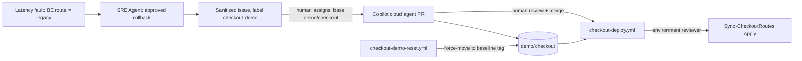

# Checkout code loop: SRE incident to reviewed config change

Implements [#44](https://github.com/rutgerpels/azure-agentic-ops/issues/44)
on top of the [checkout continuity scenario](checkout-latency-scenario.md).
SRE Agent repairs the live incident and files a sanitized drift issue. GitHub
Copilot turns the issue into a pull request. A reviewer-gated workflow applies
the declared routes. A reset workflow restores the demo branch for the next run.

**Status:** one live SRE-to-Copilot code loop verified (2026-10-18): native
human-approved rollback, connector issue creation, real Copilot cloud-agent
execution, human review/merge into `demo/checkout`, approved drift Check/Apply,
and populated reset to `demo-baseline/checkout-v3`. Human review corrected the
issue draft and requested one Copilot revision; this was not an unattended or
clean first-pass run. Post-reset deployment and healthy readiness passed.
The temporary fixture was torn down and residuals independently checked;
one-time setup is retained.

## Flow



| Step | Actor | Gate |
|---|---|---|
| Roll back the live route | SRE Agent | Review-mode approval card (unchanged) |
| Create or comment on one issue | SRE Agent GitHub connector | Issue tools are in the approval policy `ask` list |
| Open a pull request into `demo/checkout` | Copilot cloud agent | A human assigns the issue and selects the base branch |
| Merge | Human reviewer | Normal pull request review |
| Apply the declared routes | `checkout-deploy.yml` | `checkout-deploy` environment reviewer; `demo/checkout` only |
| Restore the demo | `checkout-demo-reset.yml` | `checkout-demo-reset` environment reviewer; runs from `main` only |

`main` is never a target. Copilot's change lands on `demo/checkout`, and reset
moves that branch back to an immutable tag on `main`'s history.

## Declared routes

[`scenarios/retailx/infra/checkout/price-routes.json`](../infra/checkout/price-routes.json) is the
single source of truth for `PRICE_ROUTE_BE`, `PRICE_ROUTE_NL` and
`ROUTE_CHANGE_REF`. Bicep loads it with `loadJsonContent`, and
[`scenarios/retailx/scripts/Sync-CheckoutRoutes.ps1`](../scripts/Sync-CheckoutRoutes.ps1) compares
it with the live web app:

- `Check` fails on drift; `Apply` writes only the drifted keys and reads back.
- The file must contain exactly these three keys. Routes must be `primary` or
  `legacy`, and the change reference must match `^[A-Za-z0-9._-]{1,64}$`.
- The Azure CLI query returns only the three route keys. Other app settings,
  including the Application Insights connection string, never reach the log.

The committed baseline is `primary`/`primary`/`baseline`, which matches the fault
lifecycle's baseline. Run `Ready` after the SRE rollback and **before** merging
or resetting, so the lifecycle retires the fault with evidence bound to it.
A deploy during an active fault restores the baseline routes, but `Ready` then
refuses to retire the fault because the change reference no longer belongs to
it. Recover with `Undo -Scenario latency` (idempotent) and then `Ready`.

## One-time setup

Run after merging this change. Order matters.

```powershell
$sub = '<subscription-id>'
# 1. Label and reset environment (reviewer = you, main only)
.\scenarios\retailx\scripts\Invoke-CheckoutDemoRepo.ps1 Configure
# 2. Manual: create the fine-grained token and store it as the DEMO_RESET_TOKEN
#    environment secret on checkout-demo-reset (see below)
# 3. Create the next immutable baseline tag on main and create demo/checkout if absent.
#    Keep the returned tag name; v1 is only the first baseline.
.\scenarios\retailx\scripts\Invoke-CheckoutDemoRepo.ps1 Baseline
# 4. Deploy identity and checkout-deploy environment (reviewer = you)
.\scenarios\retailx\scripts\Invoke-CheckoutDeployIdentity.ps1 Configure -SubscriptionId $sub
# 5. After checkout Up: scope the route writer role to the web app
.\scenarios\retailx\scripts\Invoke-CheckoutDeployIdentity.ps1 Grant -SubscriptionId $sub -CheckoutEnvironmentName checkout01
.\scenarios\retailx\scripts\Invoke-CopilotCloudAgent.ps1 Grant -SubscriptionId $sub -CheckoutEnvironmentName checkout01
# 6. After adding the SRE GitHub connector in the portal and listing its tools
.\scenarios\retailx\scripts\Invoke-CheckoutDemo.ps1 ConfigureFollowUp -SubscriptionId $sub -EnvironmentName checkout01 `
  -IssueRepository rutgerpels/azure-agentic-ops -SreIssueTools '<create-issue-tool>', '<search-issues-tool>', '<comment-tool>'
.\scenarios\retailx\scripts\Invoke-CheckoutDemo.ps1 Ready -SubscriptionId $sub -EnvironmentName checkout01
```

### Reset token (manual)

The reset moves `demo/checkout` across commits that may change workflow files.
`GITHUB_TOKEN` cannot push workflow changes, so the reset uses a fine-grained
personal access token:

- Repository access: this repository only.
- Permissions (read and write): Contents, Issues, Pull requests, Workflows,
  Actions.
- Expiry: about 30 days. Rotate before rehearsals.
- Store it only as the **environment** secret `DEMO_RESET_TOKEN` on
  `checkout-demo-reset`, so it is released only after a reviewer approves a run
  from `main`.

### SRE GitHub connector (manual, before rehearsal)

Follow the [Microsoft connector setup](https://learn.microsoft.com/azure/sre-agent/setup-github-connector)
in the SRE Agent portal, choosing PAT authentication. Create a **separate**
short-lived fine-grained token: this repository only, Issues read/write and
Contents read-only, with automatic Metadata read. Do not reuse `DEMO_RESET_TOKEN`
or paste either token into chat, issues or repository files.

List the connected investigator's tools to get their exact names. Pass only
issue search, create and comment tools to `ConfigureFollowUp`. Do not pass pull
request, push or assignment tools. In the verified deployment, these were the
connector-prefixed `search_issues`, `issue_write` and `add_issue_comment` tools.
All three were configured in the native `ask` policy. A harmless issue search
first demonstrated an actual pending approval and successful action-only
resume; Review mode alone was not treated as proof of connector gating.
`ConfigureFollowUp` without `-IssueRepository` disables the follow-up.

A fresh SRE deployment needs its own connector setup. After teardown, revoke
only this temporary connector token; retain the separately named reset token
when keeping the reusable demo setup.

### Fresh deployment and approval checks

Creating the baseline branch can trigger the deploy workflow before its
environment secrets or checkout target exist. That early failure is not an
OIDC test. Finish `Configure` and `Grant`, then dispatch **Checkout Routes
Deploy** on `demo/checkout` and approve its environment.

During the first fresh dry-run, ARM created the Log Analytics workspace but
the latency alert failed with **The workspace could not be found**. The
deployment was terminal, and the exact workspace's `AppRequests` query later
succeeded. Re-running the same owned `Up` then succeeded. If this occurs,
inspect the failed operation and query availability before retrying; do not
delete the ownership manifest, adopt another group or disable query
validation. A nonterminal deployment or unknown Arc command must be observed,
not replayed. Workspace propagation remains a fresh-deployment reliability
limit, not a verified automatic retry mechanism.

An SRE text proposal is not a native approval card. The dry-run initially
needed a prompt to request the exact rollback through `RunAzCliWriteCommands`.
Only the resulting native card was approved, without allow-for-thread.
The tool resumed after approval and Azure recorded the expected SRE identity's
configuration write. The resumed result did not contain another pending card;
that is not evidence that execution failed. Read the existing execution,
live routes and fresh telemetry instead of requesting the command again.

The investigator guidance now explicitly requests the native tool gate and
explains approval/resume semantics. After retiring the first fault, the
guidance was refreshed at the healthy baseline. A second independently
injected latency incident produced the exact native rollback card without a
steering message; the human again approved only that action. SRE then verified
recovery and wrote its incident note without another prompt or write replay.
Azure audit showed the bound SRE identity's successful write after approval.

Fresh telemetry established recovery before the stateful alert naturally
resolved. In this run, natural alert clearance took about 17 minutes after the
rollback; `Ready` correctly blocked reuse until then. Include this wait in
rehearsals, and do not equate an acknowledgement or the agent's description of
an alert-history state change with Monitor's `Resolved` condition. Review
incident-note timestamps against the approval and configuration-write audit.
This dry-run does not establish a 12-minute end-to-end presentation.

### Full code-loop run

The subsequent fresh deployment succeeded without the workspace-propagation
retry. For `CHG-35a0d0b27eb7`, the latency investigator produced its native
rollback card without steering. The human approved that action only; Activity
Log matched the configured SRE action identity. SRE independently queried
recovery: BE p95 164 ms and NL 169 ms, 58 successful requests each, on primary
routes. The query ran at 12:47:52-12:47:56 UTC using `ago(3m)`.

Separate action-only approvals covered the connector duplicate search and
issue creation. Exactly one [issue #51](https://github.com/rutgerpels/azure-agentic-ops/issues/51)
was created. The human stopped the investigation after approving the write,
but the issue had already been created. Execution was inspected, not replayed,
and SRE was not restarted. Human review corrected the issue's unsupported
later recovery window and missing Agile metadata on that same issue.
Natural alert resolution and `Ready` retired the fault before code deployment.

Human assignment from `demo/checkout` started the actual
[Copilot job](https://github.com/rutgerpels/azure-agentic-ops/actions/runs/39130522279).
It used the configured OIDC setup and Azure MCP to read the scoped checkout
resource-group inventory. [PR #52](https://github.com/rutgerpels/azure-agentic-ops/pull/52)
targeted the correct demo branch. Its first implementation added a standalone
manual workflow only on that non-default branch; GitHub did not register it.
[Manual workflows must exist on the default branch](https://docs.github.com/en/actions/how-tos/manage-workflow-runs/manually-run-a-workflow).
A requested Copilot revision reused the existing registered
`checkout-deploy.yml`, adding `mode=apply|check`, with Apply as the default.
The reviewed revision passed 43 code-loop and 117 lifecycle checks. Human
approval and merge preceded the live workflow executions.

## Demo run

1. `Ready`, then `Inject -Scenario latency`; approve the SRE rollback as usual.
2. Review the SRE issue-creation card **before approval**: sanitized resource
   references, evidence-backed UTC timestamps, Agile task fields, the
   `checkout-demo` label, and target `demo/checkout`. Reject an incorrect draft.
   It should reference the change, `price-routes.json` and `checkout.bicep`,
   and request a missing drift check/regression contract, not recreate existing
   route declarations.
3. Wait for fresh healthy evidence and run `Ready` to retire the fault.
4. Assign the issue to Copilot and choose base branch **`demo/checkout`**.
5. Review Copilot's pull request, request corrections if needed, mark it Ready
   for review if still a draft, then approve and merge into `demo/checkout`.
   Retain the head branch and demo issue when testing populated reset.
6. Approve the `checkout-deploy` environment run. The step summary shows
   declared versus live routes; it resets the leftover fault change reference
   to `baseline`.

Stopping SRE after approval does not undo an already executed tool call.
Inspect the existing execution and GitHub issue before requesting another
write; correct an existing issue rather than creating a duplicate.

### Exercising the disposable drift-check addition

PR #52 added Check mode **only to the disposable demo branch**, not `main`.
After reset to v3 the original Apply-only workflow is restored. The commands
below require a reviewed code-loop change providing that input on
`demo/checkout`; they are not supported by the restored v3 workflow.

To demonstrate non-writing drift detection, leave the automatic post-merge
Apply waiting, then cancel that specific pending run. This preserves the
leftover fault marker and releases the shared workflow concurrency slot.
Never cancel an unrelated run or approve Apply before capturing this drift.

```powershell
gh workflow run checkout-deploy.yml --ref demo/checkout -f mode=check
# Human approves checkout-deploy; expect failure naming ROUTE_CHANGE_REF only.
gh workflow run checkout-deploy.yml --ref demo/checkout -f mode=apply
# Human approves; verify the marker becomes baseline.
gh workflow run checkout-deploy.yml --ref demo/checkout -f mode=check
# Human approves again; expect in sync.
```

Check is operationally non-writing but uses the existing write-capable deploy
identity and reviewer gate; it is not a separate read-only RBAC identity.
The live run verified this three-step sequence. Only Apply produced a
configuration-write event in that interval, with the expected deploy identity.
Apply was followed by temporarily elevated p95 and intermittently stale Arc
observations. No threshold was weakened or fault reinjected: after waiting,
`Ready` passed at BE 110 ms (96 requests), NL 136 ms (97), with fresh healthy
service evidence. Allow time for the full readiness window, not just ARM
configuration readback.

## Reset

Actions → **Checkout Demo Reset** → Run workflow on `main` (baseline tag
equal to the selected run's immutable baseline), then approve the environment.
Preview locally with `Reset -BaselineTag <tag> -WhatIf` first. The reset:

1. Comments on and closes open pull requests into `demo/checkout`.
2. Deletes same-repository `copilot/*` head branches of open, merged or closed
   pull requests into `demo/checkout`, except branches an open pull request into
   another base still uses.
3. Closes open `checkout-demo` issues as not planned.
4. Force-moves `demo/checkout` to the tag commit and verifies it.

Moving the branch triggers the gated deploy, which restores the baseline routes.
Set `redeploy` only if the branch was already at the baseline.
`Invoke-CheckoutDemoRepo.ps1 Check` reports whether the branch is at baseline
and lists open demo items. The same `Reset` action can run locally with `gh`.

To adopt newer `main` content, run `Baseline` to create the next
`demo-baseline/checkout-vN` tag, then reset to it. Baseline tags must be
lightweight tags on `main`'s history.

The first technical dry-run used v2; the populated code-loop run used
`demo-baseline/checkout-v3`. For the latter, explicitly pass
`-BaselineTag demo-baseline/checkout-v3` to `Check` and `Reset`, and select v3
in the reset workflow. The default v1 input does not automatically follow newer
tags. Baseline tags are immutable; create a new version rather than moving one.

The populated reset closed issue #51 as not planned, deleted its retained
merged Copilot head branch, and restored the demo branch to v3. PR #52 remains
merged in GitHub history. There was no open PR at reset time, so live
open-PR closure is still unverified. Independent reads confirmed `main` was
unchanged, no open demo issues/PRs remained, and the baseline deployment and
`Ready` passed: BE p95 148 ms (88 requests), NL 138 ms (89), fresh healthy Arc
service evidence.

## Teardown

For a normal completed run, remove the temporary checkout fixture, not the
reusable identity setup:

```powershell
.\scenarios\retailx\scripts\Invoke-CheckoutDemo.ps1 Down -SubscriptionId $sub -EnvironmentName checkout01
```

Preserve the ownership manifest until `Down` verifies completion. The full-loop
teardown needed idempotent retries while owned ARM deployment-record deletions
propagated; the manifest remained available throughout. Observe an unknown or
nonterminal operation rather than assuming it did not execute.

Independent checks found no fixture group, owner-tagged active resources,
subscription grants, Arc or route-writer custom roles, owned Monitor default
setting, deployment records, or deploy/Copilot assignments. Normal Azure
soft-delete/data retention was not purged. After successful teardown, remove
the generated break-glass key, frontend package and temporary review archive.
Keep the non-secret ownership/residual receipts.

The reusable identity groups, GitHub environments and reset secret are
intentionally retained. Repeat both `Grant` actions after the next `Up`;
create/configure the fresh SRE connector separately. The human confirmed
revocation of this run's seven-day connector PAT, not the reset token.

Only when retiring the reusable demo setup, run:

```powershell
.\scenarios\retailx\scripts\Invoke-CheckoutDeployIdentity.ps1 Remove -SubscriptionId $sub
.\scenarios\retailx\scripts\Invoke-CopilotCloudAgent.ps1 Remove -SubscriptionId $sub
```

These remove the respective owned identity setup and local state. Delete the
reset environment/secret, `demo/checkout` and baseline tags separately when the
demo is permanently retired.

## Limits

- The route writer role includes `Microsoft.Web/sites/config/write` and
  `config/list/action` on one web app. It can change any app setting on that
  app, not only routes; the workflow and reviewer gate keep it to the declared
  keys.
- A pull request into `demo/checkout` may change `checkout-deploy.yml` itself.
  It is still bounded by human merge review, the environment reviewer and the
  single-app role.
- The reset token has write access to this repository. Keep it short-lived and
  environment-scoped.
- Connector approval was verified for the exact configured tool names in this
  deployment. Recheck names and gating for each fresh connector.
- The generated issue is not automatically validated against the Agile schema
  or its claimed UTC evidence window. The live draft needed human correction.
- The completed loop used a residual marker mismatch for the live drift test,
  not a second latency injection after merging the PR. That reinjection
  acceptance, live open-PR reset, timed rehearsal and three fresh repeat cycles
  remain separate gates. The first draft and first Copilot implementation
  both needed review corrections.

## Verification status

| Item | Status |
|---|---|
| Route validation, drift detection, key-only query | `scenarios\retailx\tests\Test-CheckoutCodeLoop.ps1` (mocked) |
| Reset touches only demo pull requests, issues and branch | `scenarios\retailx\tests\Test-CheckoutCodeLoop.ps1` (mocked) |
| Repository Check/Reset and deploy-identity Check cardinality | Actual entry functions exercised with empty, singleton and multiple mocked results, plus a missing deploy environment |
| Workflow guards and pinned actions | `scenarios\retailx\tests\Test-CheckoutCodeLoop.ps1` (static) |
| Follow-up instruction, tools and approval drift | `scenarios\retailx\tests\Test-CheckoutDemo.ps1` (mocked) |
| Bicep build with loaded routes | `az bicep build` |
| Scoped deploy/Copilot identities | Live readback: route writer on one checkout app; Copilot Reader on its resource group only |
| GitHub OIDC and route read | Human-approved [dry-run](https://github.com/rutgerpels/azure-agentic-ops/actions/runs/39109848892) passed with routes already matching |
| Live latency fault and approved rollback | Full-loop run: native rollback card without steering, action-only human approval, and the expected SRE action identity's successful write; recovery independently queried by SRE |
| Fresh recovery and fault retirement | Full-loop run: SRE reported BE/NL p95 164/169 ms, 58 successful requests each. After natural alert resolution, `Ready` passed at 127/113 ms with 97 samples each and retired the fault before code deployment |
| PAT-backed populated reset | Human-approved [v3 reset](https://github.com/rutgerpels/azure-agentic-ops/actions/runs/39133937751) closed issue #51 and deleted the retained merged Copilot branch. `demo/checkout` matched v3, `main` was unchanged, zero open demo items remained. Open-PR closure was not exercised |
| Earlier scoped route-write dry-run | Human-approved [post-reset deploy](https://github.com/rutgerpels/azure-agentic-ops/actions/runs/39119652888) wrote the leftover change reference to `baseline` and read back all three declared keys. `Ready` then passed at BE p95 187 ms (n=96), NL 210 ms (n=99) |
| Fixture teardown | Fresh full-loop fixture independently verified absent, including owner-tagged active resources, Arc/route-writer roles, subscription grants, owned Monitor setting/deployment records and deploy/Copilot assignments. Propagating deployment-record deletions required idempotent retries with the manifest retained. One-time identity groups, GitHub environments and reset secret remain; the human revoked the connector PAT. Normal Azure soft-delete/data retention was not purged |
| SRE issue creation and Copilot PR | Native action-only connector approvals created exactly one issue #51; human correction and Copilot assignment produced PR #52. Actual OIDC/Azure MCP Reader use, one requested code revision, and human approval/merge into `demo/checkout` were verified |
| Live non-writing drift Check | Approved [Check](https://github.com/rutgerpels/azure-agentic-ops/actions/runs/39132524668) failed only on the residual `ROUTE_CHANGE_REF`; live values were unchanged |
| Live Apply and matching Check | Approved [Apply](https://github.com/rutgerpels/azure-agentic-ops/actions/runs/39133192821) restored/read back `baseline`, with the expected deploy identity's write; subsequent [Check](https://github.com/rutgerpels/azure-agentic-ops/actions/runs/39133270449) passed in sync |
| Post-reset baseline | Approved [baseline deployment](https://github.com/rutgerpels/azure-agentic-ops/actions/runs/39135028460) passed already in sync. Fresh `Ready` passed with BE/NL p95 148/138 ms and healthy Arc evidence |
