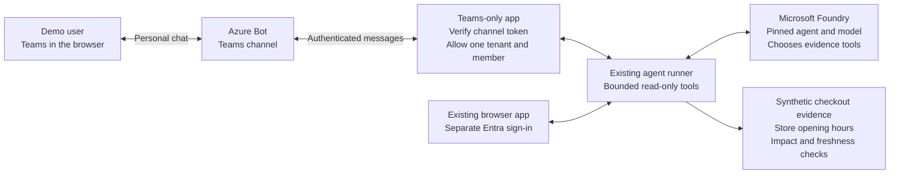

# Retailx personal Teams pilot

**Source implementation, not live Teams acceptance.** This optional extension
adds a personal Teams conversation to the existing read-only Foundry assistant.
Its Azure resources, managed identities and Teams installation require a
separate deployment approval. No VM, desktop Teams client or runtime Microsoft
Graph permission is needed.

## High-level architecture



Think of Teams as a **new front door**, not a new AI engine. Azure Bot carries
the messages. A separate app checks who sent them, then reuses the existing
agent runner. Foundry chooses from the allowed tools; application code executes
them and checks freshness. The answer returns to the same personal chat with
a synthetic-evidence banner and observation/query timestamps.

The runner is shared **source code**, not an unauthenticated browser API call.
The browser and Teams processes keep their own authorization and conversations.
The browser can retain its separately approved live checkout attachment; the
Teams pilot is fixture-only and has no checkout workspace role.

SRE Agent and its native human-approved repairs stay outside this assistant.
There is no repair path, arbitrary KQL/shell tool, incident write, revenue
estimate, group/channel support or proactive staff notification.

## What the first pilot should demonstrate

| Question or action | Expected result |
|---|---|
| `/help` | Read-only boundaries and available commands; no model call. |
| Ask which BE/NL stores opening soon need attention | Real Foundry reasoning selects bounded tools and combines synthetic checkout/store evidence. |
| `/fixture interrupted`, then ask about impact | Clearly synthetic affected/exposed stores and limitations. The command changes no infrastructure. |
| Ask to check again | A new Foundry turn and fresh tool reads, not replay of the earlier answer. |
| `/fixture stale` or `/fixture unavailable` | Explicit unknown; no invented health or recovery. |
| `/fixture recovering` | Do not claim customer recovery without the required evidence. |
| `/status` | Last question's receipt, optionally its saved answer, labeled **not a fresh observation**. No model call or delivery retry. |
| `/reset` | Clear history and select healthy synthetic evidence; no real recovery action. |
| Duplicate delivery or process restart | Never repeat the original inference automatically. An uncertain outcome stays uncertain. |

Changing fixtures clears conversational history, so it does not by itself
demonstrate a single incident's recovery. No fixture proves a real checkout
incident or a Teams conversation actually worked.

## Deployment and ownership

Use the existing `Invoke-IncidentAgent.ps1` entry point with explicit authorized
subscription, tenant and environment values. The worktree must hold that
environment's own `.azure\<environment>\incident-agent-ownership.json`; do not
copy/adopt another checkout's state or resources by name.

1. Obtain human review and merge of the source PR. Confirm the exact Azure
   resources, identities, member object ID, tenant custom-app policy and
   retention before authorizing deployment.
2. Establish the separately owned browser/Foundry environment with `Up` if
   needed. It must have a pinned, endpoint-confirmed agent version.
3. Run `TeamsUp -TeamsUserObjectId <member-object-guid>` for that same owned
   environment. The account must be an enabled tenant **Member** with Teams
   licensing; the operator supplies its immutable object ID privately.
4. Run `TeamsReady` and `TeamsVerify` in Azure. They check the deployed boundary
   and run the existing cloud fixture evaluations; neither proves user chat.
5. After tenant policy approval, upload the generated private
   `.azure\<environment>\retailx-teams-personal.zip` as the bound demo member.
   Install in personal scope only; do not publish to the tenant catalog.
6. Rehearse the table above in Teams. Keep a private, same-run receipt of the
   actual Foundry tool selections, fresh follow-up, stale/unknown handling and
   unauthorized/group-scope rejection. Do not record passwords or raw chats.

For example (replace every placeholder; do not save live values in source):

```powershell
.\scenarios\retailx\scripts\Invoke-IncidentAgent.ps1 TeamsUp `
    -SubscriptionId <subscription-guid> -TenantId <tenant-guid> `
    -EnvironmentName assist01 -TeamsUserObjectId <member-object-guid>
```

The subscription owner must have registered `Microsoft.BotService`; the script
does not silently register providers or broaden tenant policy. `-WhatIf`
declines mutations. Actual provisioning performs template validation and ARM
what-if first and retains a private preview.

| Owned component | Purpose and boundary |
|---|---|
| Separate Python 3.12 App Service, same owned B1 plan/RG | Teams endpoint only; browser Easy Auth exclusions remain unchanged. |
| Azure Bot and its Teams channel | Channel transport to the exact Teams app endpoint. |
| Dedicated bot user-assigned managed identity | Secretless bot authentication; no Azure resource roles. No extra bot app registration or Graph runtime permissions. |
| Teams host system-assigned identity | Foundry Agent Consumer at the exact existing project, not contributor/admin or checkout reader. |
| Foundry outbound-IP allowlist | Exact union of browser and enabled Teams hosts; key authentication remains disabled. This is not Private Link. |
| Existing root ownership manifest | Persists opt-in, member/package IDs and resource bindings; ordinary `Up` preserves the optional Teams surface. |
| Generated personal app ZIP | Contains private environment identifiers; never commit or publish it. |

`TeamsPackage` regenerates the same personal app identity. Ordinary `Reset`
rotates the shared evidence run and restarts both enabled apps; previous
Teams history/receipts are not admitted in the new run. `/reset` is only a
conversation reset. Setup selects healthy fixtures and never injects a fault.

## Runtime limits and failure behavior

The Microsoft 365 Agents SDK verifies channel JWT signatures. The application
then requires the commercial channel issuer, exact bot audience, tenant,
member object ID, bot recipient and personal scope. It accepts only recent
messages and allowlisted commercial Teams service URLs. Files, cards, invokes
and arbitrary payloads cannot reach the agent. A single bounded Teams
`text/html` presentation attachment is ignored; only the plain `text` is used,
and its HTML is never rendered or fetched.

Only the constant `/health/live` is anonymous. The Teams host does not use the
browser's cookies or CSRF exemptions, nor does it expose the browser UI.
Content is plain text. Telemetry contains bounded event metadata, not prompts,
identities, token values or raw upstream exceptions. Teams runs Azure Monitor
in logs-only mode: SDK spans/metrics and live metrics are disabled because
SDK spans can contain conversation IDs and exception details. Its default
traceback/raw-error chat callback is replaced with the sanitized failure path.

Incoming requests get a short acknowledgement; a tracked background task uses
the existing bounded runner and sends its delayed answer to the originating
conversation. The SDK calls this continuation delivery; it is not unsolicited
proactive staff messaging. If inference or delivery is interrupted, `/status`
reports saved evidence or uncertainty, without rerunning inference or delivery.
`delivered` means the channel accepted the reply, not that the user read it.

Owned App Service `/home/data` files hold atomic activity claims, one active
operation, bounded conversation history and receipts. Restart never resumes
work. A stale active claim requires explicit `/reset` after four minutes.
The plan and app must remain **one instance and one worker**; scale-out and
production/high-availability delivery guarantees are not implemented.
The first slice allows at most six new activities/minute, eight conversation
sessions and eight model turns/session. History retains at most four turns
with bounded answer excerpts; every follow-up still fetches new evidence.
Sessions expire after 30 minutes. Receipt cleanup is opportunistic on accepted
traffic after one hour; old run namespaces remain private until owned app/RG
teardown. These are not guaranteed data-erasure timers.

No automatic model/delivery retries, queue, Graph conversation inventory,
file upload, multitenant access or live checkout evidence is added here.
Model/SDK transport timeouts do not establish that an upstream request never
executed.

## Cleanup and longer-term path

`TeamsDown` stops the Teams host, removes its exact runtime grant, bot, host
and managed identity, checks their absence, restores the browser-only Foundry
allowlist and keeps the browser environment. Full `Down` removes the owned
incident RG (including Teams) and the existing browser registration.
Neither operation changes the demo user's account or Teams license.

**Uninstall the personal app in Teams separately.** Without broad Graph
inventory permission, neither lifecycle claims to remove tenant/catalog/client
installations. Azure/Entra provider-retained or soft-deleted data may remain;
cleanup is not a purge claim. Keep ownership and residual receipts.
After an interrupted first Teams provision with no recorded output bindings,
inspect the owned deployment and use full `Down` if scoped cleanup cannot
establish those bindings; never adopt a same-name bot.

After actual personal-chat acceptance, a separately reviewed next slice can
add live checkout telemetry with its own scoped reader grant and aligned
synthetic store map. Rehearse a presenter-triggered incident and recovery
before considering any staff rollout or proactive notifications.

## Privacy

This is an internal synthetic-data pilot, not a customer service. Do not send
customer data, personal data, credentials or operational secrets. Prompts and
bounded answer history are processed by the authorized Foundry endpoint and
the private app; Teams retains messages under tenant policy. Generated
packages and ownership/receipt files contain private environment identifiers.
The app does not request runtime Graph permissions or log prompt content.

## Terms of use

Use only in the explicitly authorized demo tenant and personal scope. Outputs
are illustrative and require human judgment. They are not production incident
instructions, evidence of real recovery, or authorization to change resources.
Tenant custom-app controls and native SRE human approvals must not be bypassed.

## Authoritative references

- [Microsoft 365 Agents SDK overview](https://learn.microsoft.com/microsoft-365/agents-sdk/agents-sdk-overview)
- [Official Python Agents SDK source](https://github.com/microsoft/Agents-for-python)
- [Azure Bot resource schema and managed identity fields](https://learn.microsoft.com/azure/templates/microsoft.botservice/2022-09-15/botservices)
- [Teams app manifest schema](https://learn.microsoft.com/microsoftteams/platform/resources/schema/manifest-schema)

The implementation pins the hosting and MSAL Agents packages to `1.9.0`.
Context7 was quota-blocked during implementation; the SDK interfaces and
identity configuration were checked against official source and the installed
pinned packages instead. Engineering tests are not cloud deployment or Teams
acceptance evidence.
